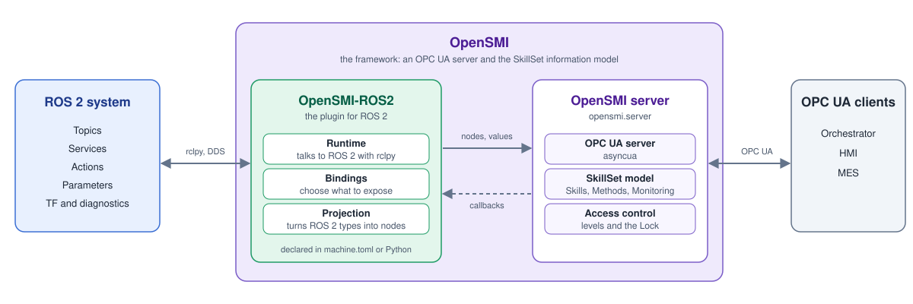
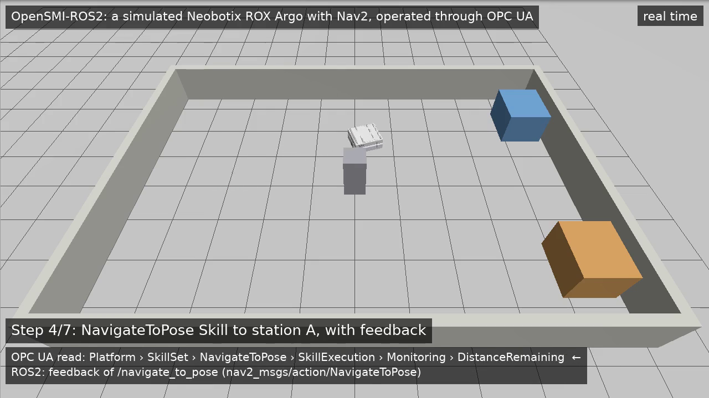
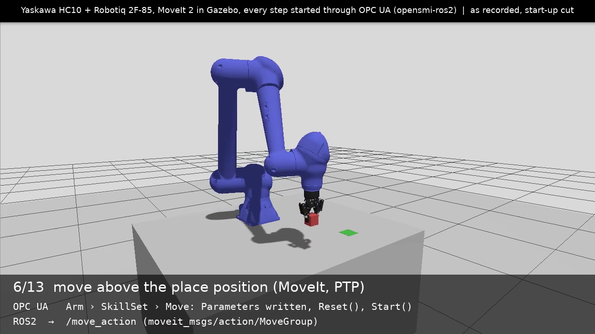

[](https://smartfactory-kl.github.io/opensmi-ros2/)
[](https://pypi.org/project/opensmi-ros2/)
[](https://pypi.org/project/opensmi-ros2/)
[](https://github.com/SmartFactory-KL/opensmi-ros2/blob/main/LICENSES/MIT.txt)

# OpenSMI-ROS2

OpenSMI-ROS2 serves a ROS 2 system as an [OPC UA](https://opcfoundation.org/about/opc-technologies/opc-ua/) server. It builds on opensmi.server and the
SmartFactory-KL SkillSet information model, so an OPC UA client sees a robot as a Machine with
Components that carry Skills, Methods and Monitoring variables instead of a list of [topics](https://docs.ros.org/en/jazzy/Concepts/Basic/About-Topics.html), [services](https://docs.ros.org/en/jazzy/Concepts/Basic/About-Services.html)
and [actions](https://docs.ros.org/en/jazzy/Concepts/Basic/About-Actions.html).

You choose what to expose by declaring Bindings on a Component, in Python or in one TOML file. A
Binding ties one ROS 2 [topic](https://docs.ros.org/en/jazzy/Concepts/Basic/About-Topics.html), [service](https://docs.ros.org/en/jazzy/Concepts/Basic/About-Services.html), [action](https://docs.ros.org/en/jazzy/Concepts/Basic/About-Actions.html),
[parameter set](https://docs.ros.org/en/jazzy/Concepts/Basic/About-Parameters.html), [lifecycle node](https://design.ros2.org/articles/node_lifecycle.html),
[TF tree](https://docs.ros.org/en/jazzy/Concepts/Intermediate/About-Tf2.html) or diagnostics topic to its place in the OPC UA address space.



OpenSMI-ROS2 is the project name. The Python distribution and the command-line executable are named
`opensmi-ros2`, and the public Python namespace is `opensmi.ros2`. A Binding maps a ROS 2 interface to
an OPC UA representation; [docs/bindings.md](https://github.com/SmartFactory-KL/opensmi-ros2/blob/main/docs/bindings.md) lists the eight kinds.

> [!warning]
> This library is pre-1.0. Expect changes to the machine file, the OPC UA address space and the Python API;
> [docs/migration.md](https://github.com/SmartFactory-KL/opensmi-ros2/blob/main/docs/migration.md) lists every change that breaks a client.

## Features

| ROS 2 side | OPC UA side | Direction |
| --- | --- | --- |
| [Topic](https://docs.ros.org/en/jazzy/Concepts/Basic/About-Topics.html) | Monitoring variables | ROS 2 to OPC UA |
| [Topic](https://docs.ros.org/en/jazzy/Concepts/Basic/About-Topics.html) | Skill that publishes while it runs | OPC UA to ROS 2 |
| [Service](https://docs.ros.org/en/jazzy/Concepts/Basic/About-Services.html) | Method | OPC UA to ROS 2 |
| [Action](https://docs.ros.org/en/jazzy/Concepts/Basic/About-Actions.html) | Skill with feedback and a Result | OPC UA to ROS 2 |
| [Lifecycle node](https://design.ros2.org/articles/node_lifecycle.html) or lifecycle manager | StartupSkill | both |
| [TF tree](https://docs.ros.org/en/jazzy/Concepts/Intermediate/About-Tf2.html) | [Locations](https://reference.opcfoundation.org/specs/OPC-10000-210) inside a SpatialObject (OPC 10000-210, Relative Spatial Location) | both, per frame |
| [`/diagnostics`](https://docs.ros.org/en/jazzy/p/diagnostic_msgs/) | One member per diagnostic id, and an event per level change | ROS 2 to OPC UA |
| A node's [ROS 2 parameters](https://docs.ros.org/en/jazzy/Concepts/Basic/About-Parameters.html) | Writable Parameters | both |

A whole server starts from one TOML file with `opensmi-ros2 serve`, and every Machine carries a
`ROS2Introspection` Component that lists the ROS 2 graph. The [architecture](https://github.com/SmartFactory-KL/opensmi-ros2/blob/main/docs/architecture.md)
page has the rest.

## Quick start

You need Linux, ROS 2 Jazzy and Python 3.11 or newer. From a clone:

```sh
. /opt/ros/jazzy/setup.bash
python3 -m venv --system-site-packages .venv
. .venv/bin/activate
python -m pip install -c constraints.txt -e .
```

Keep the `-c constraints.txt`: it pins the opensmi versions the code is tested against. Then save
this as `machine.toml`:

```toml
[machine]
name = "Robot"

[machine.identification]
serial_number = "0001"
manufacturer = "Example"
product_instance_uri = "urn:example:robot"

[[component]]
name = "Platform"

[component.identification]
serial_number = "0001-platform"
manufacturer = "Example"

[[component.monitoring]]
name = "Odom"
path = "/odom"
message_type = "nav_msgs/msg/Odometry"
```

and start the server:

```sh
opensmi-ros2 serve machine.toml
```

It listens on `opc.tcp://localhost:4841/server`, and the odometry is the variable
`Platform/Monitoring/Odom`. [Getting started](https://github.com/SmartFactory-KL/opensmi-ros2/blob/main/docs/getting-started.md) explains the checks and what
you see in a client. To operate a Machine from a client, with the Lock, a Skill and its errors, run the
script in the [client quickstart](https://github.com/SmartFactory-KL/opensmi-ros2/blob/main/docs/client-quickstart.md).

## Examples

[`examples/`](https://github.com/SmartFactory-KL/opensmi-ros2/blob/main/examples/README.md) holds the example Machine in TOML and Python, the Machine and
client of the [client quickstart](https://github.com/SmartFactory-KL/opensmi-ros2/blob/main/docs/client-quickstart.md), and two complete simulated robots that
run in Docker with one command. Click a picture for the video of a whole run:

| [`nav2-rox-argo`](https://github.com/SmartFactory-KL/opensmi-ros2/blob/main/examples/nav2-rox-argo/README.md) | [`moveit-hc10-robotiq`](https://github.com/SmartFactory-KL/opensmi-ros2/blob/main/examples/moveit-hc10-robotiq/README.md) |
| --- | --- |
| [](https://github.com/SmartFactory-KL/opensmi-ros2/blob/main/examples/nav2-rox-argo/media/rox-argo.mp4) | [](https://github.com/SmartFactory-KL/opensmi-ros2/blob/main/examples/moveit-hc10-robotiq/media/hc10-pick-and-place.mp4) |
| A Neobotix ROX Argo with Nav2 in Gazebo | A Yaskawa HC10 with a Robotiq 2F-85 and MoveIt in Gazebo |

## Documentation

The [documentation](https://github.com/SmartFactory-KL/opensmi-ros2/blob/main/docs/README.md) covers:

- [Getting started](https://github.com/SmartFactory-KL/opensmi-ros2/blob/main/docs/getting-started.md): install, serve a Machine, run and stop.
- [Client quickstart](https://github.com/SmartFactory-KL/opensmi-ros2/blob/main/docs/client-quickstart.md): a runnable OPC UA client that logs in, takes the
  Lock, starts a Skill and shows the errors the server answers with.
- [Architecture](https://github.com/SmartFactory-KL/opensmi-ros2/blob/main/docs/architecture.md): the two halves and the Bindings.
- [Configuration](https://github.com/SmartFactory-KL/opensmi-ros2/blob/main/docs/configuration.md): the machine file, `[ros2]` and the opensmi server.
- [Writing a server in Python](https://github.com/SmartFactory-KL/opensmi-ros2/blob/main/docs/python-api.md).
- [Bindings](https://github.com/SmartFactory-KL/opensmi-ros2/blob/main/docs/bindings.md): the reference for all eight kinds, with fields, rules and examples.
- [Browse paths](https://github.com/SmartFactory-KL/opensmi-ros2/blob/main/docs/browse-paths.md) and [publishing Bindings](https://github.com/SmartFactory-KL/opensmi-ros2/blob/main/docs/publishing-bindings.md).
- [Deployment](https://github.com/SmartFactory-KL/opensmi-ros2/blob/main/docs/deployment.md): users, encryption, the ROS 2 network and the robot's own safety.
- [Testing](https://github.com/SmartFactory-KL/opensmi-ros2/blob/main/docs/testing.md).
- [Changes that break a client](https://github.com/SmartFactory-KL/opensmi-ros2/blob/main/docs/migration.md).

## Versioning

OpenSMI-ROS2 follows [Semantic Versioning](https://semver.org). Before 1.0.0 a change that breaks
the machine file, the OPC UA address space or the Python API raises the minor version and is listed
in [docs/migration.md](https://github.com/SmartFactory-KL/opensmi-ros2/blob/main/docs/migration.md); a patch release never breaks anything.

## Contributing

[CONTRIBUTING.md](https://github.com/SmartFactory-KL/opensmi-ros2/blob/main/CONTRIBUTING.md) covers the setup, the checks CI runs, the rules for the public API
and the commit conventions (Conventional Commits, with a changelog generated by git-cliff).

## Contact

Benjamin Blumhofer, Technologie-Initiative SmartFactory KL e.V.,
<benjamin.blumhofer@smartfactory.de>. Report bugs and questions in the
[issue tracker](https://github.com/SmartFactory-KL/opensmi-ros2/issues).

## AI disclaimer

OpenSMI-ROS2 builds on two earlier versions of a project that was written by hand. The software
design, the architecture and the decisions behind it come from the maintainers. An AI coding
assistant (Claude, by Anthropic) helped with the implementation. The maintainers review what is
merged and are responsible for it, but code written with AI help can still contain mistakes. Test
it before you rely on it, and do not run it on a real machine without safeguards.

## License

OpenSMI-ROS2 is licensed under the MIT License; see [LICENSES/MIT.txt](https://github.com/SmartFactory-KL/opensmi-ros2/blob/main/LICENSES/MIT.txt). Copyright
2026 Technologie-Initiative SmartFactory KL e.V.

Some files in the repository are third-party and keep their own licences, as recorded in
[REUSE.toml](https://github.com/SmartFactory-KL/opensmi-ros2/blob/main/REUSE.toml): the vendored ROS 2 interface definitions in `catalog/packages/`
(BSD-3-Clause and Apache-2.0) and the vendored ROS 2 parser in `tools/catalog/_vendor/` (Apache-2.0).
The licence texts are in [LICENSES/](https://github.com/SmartFactory-KL/opensmi-ros2/tree/main/LICENSES).
