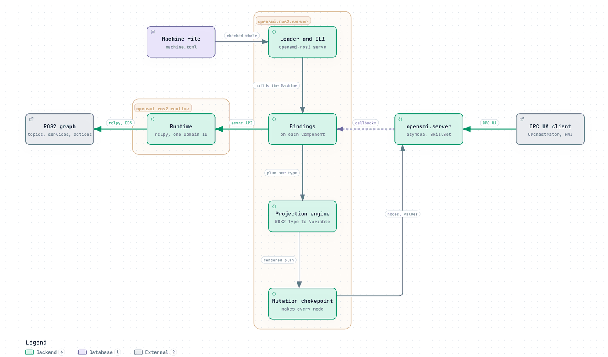

# Architecture

The package has two halves. `opensmi.ros2.runtime` is the only part that imports rclpy. One Runtime
owns one rclpy Context on its own Domain ID, one node and one executor thread, and it hands every
callback over to the asyncio loop. It never imports opensmi or asyncua, so it runs and is tested
without an OPC UA server.

`opensmi.ros2.server` sits on top of opensmi.server. `opensmi-ros2 serve` reads and checks the whole
machine file, then builds the Machine with its Components and their Bindings. Each Binding talks to
ROS 2 only through the Runtime's async API. The Projection engine turns a ROS 2 type into a plan for
its OPC UA nodes. The mutation chokepoint is the only code that creates those nodes, and it writes
each message with all of its nodes in one call.

The other direction goes through opensmi. When a client starts a Skill, calls a Method or writes a
Parameter, opensmi calls back into the Binding, and the Binding sends the goal, the request or the
message through the Runtime.

## Bindings

Each kind of Binding maps one ROS 2 interface to an OPC UA object:

| ROS 2 side | OPC UA side | Direction |
| --- | --- | --- |
| Topic | Monitoring variables | ROS 2 to OPC UA |
| Topic | Skill that publishes while it runs | OPC UA to ROS 2 |
| Service | Method | OPC UA to ROS 2 |
| Action | Skill with feedback and a Result | OPC UA to ROS 2 |
| Lifecycle node or lifecycle manager | StartupSkill | both |
| TF tree | Locations ([OPC 10000-210](https://reference.opcfoundation.org/specs/OPC-10000-210), Relative Spatial Location, RSL) inside a SpatialObject | both, per frame |
| `/diagnostics` | One member per diagnostic id, and an event per level change | ROS 2 to OPC UA |
| A node's ROS 2 parameters | Writable Parameters, with ROS 2's answer as the status code | both |

Beyond the Bindings themselves:

- A whole server can start from one TOML file with `opensmi-ros2 serve`, with no Python of your own.
  The file is checked completely before anything starts, and all its mistakes are reported at once.
- A ROS 2 message becomes a complex Variable. A client can read the whole message atomically or
  subscribe to a single field.
- Every Machine carries a `ROS2Introspection` Component. Its Methods list the topics, services,
  actions and parameters on the ROS 2 graph and the declared Bindings, and an operator can bind a
  topic ad hoc with `BindTopic`.
- Projections control how a ROS 2 type is rendered: with fields dropped, as an enumeration, a scalar
  or a blob, or through your own functions.
- The ROS 2 half (`opensmi.ros2.runtime`) never imports opensmi or asyncua, so it can be used and
  tested without an OPC UA server.
