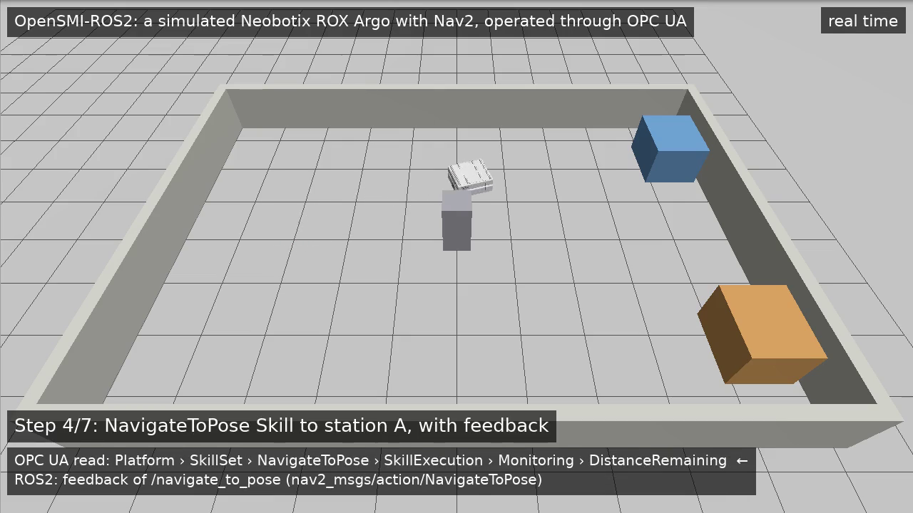
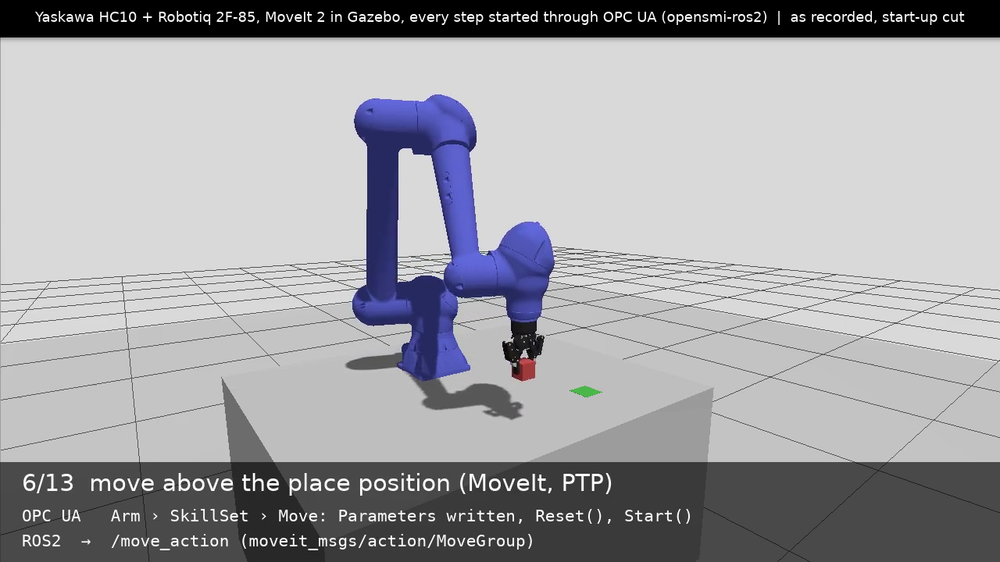

# Examples

Four examples show the package at different sizes. The first two need ROS 2 Jazzy on your machine.
The other two run in Docker and need nothing else.

| Example | What it is | How to run it |
| --- | --- | --- |
| [`machine.toml`](machine.toml), [`machine.py`](machine.py), [`component.py`](component.py) | A Nav2-style platform with one Binding of every kind, declared once in TOML and once in Python | `opensmi-ros2 serve examples/machine.toml` or `python -m examples.run_server`, from the repository root |
| [`client`](client/machine.toml) | A small Machine with one action and one service from the Jazzy demos, and an OPC UA client that walks through login, browse path, Lock, Skill start, Method call and the error states | see [docs/client-quickstart.md](../docs/client-quickstart.md) |
| [`nav2-rox-argo`](nav2-rox-argo/README.md) | A simulated Neobotix ROX Argo with Nav2 in Gazebo, driven to two stations, halted and sent home through OPC UA | `examples/nav2-rox-argo/run.sh` |
| [`moveit-hc10-robotiq`](moveit-hc10-robotiq/README.md) | A simulated Yaskawa HC10 with a Robotiq 2F-85 and MoveIt in Gazebo, picking up a cube and placing it | `examples/moveit-hc10-robotiq/run.sh` |

## The example Machine

`machine.toml` and the two Python files declare the same Machine, and `tests/test_examples.py`
checks that they stay equal. Several of its types come from `nav2_msgs`, so that interface package
has to be installed. A running Nav2 stack is not needed: the server starts either way, and its
Bindings wait for their ROS 2 counterparts. Both ways run on ROS 2 domain 42. The Python version reads
its ROS 2 settings from `ros2.toml`.

## The simulated robots

Both folders work the same way. One command builds a Docker image, starts the simulation and the
Machine, runs a scripted OPC UA client through a scenario and writes a report with PASS or FAIL per
step. Everything is removed again afterwards, also when a step fails. The client uses OPC UA only,
so the report shows what an Orchestrator can do with the robot without touching ROS 2.

|  | `nav2-rox-argo` | `moveit-hc10-robotiq` |
| --- | --- | --- |
| Robot | Neobotix ROX with the Argo drive | Yaskawa HC10 with a Robotiq 2F-85 |
| Simulation | Gazebo Harmonic, Nav2 | Gazebo Harmonic, MoveIt 2, ros2_control |
| Scenario | StartupSkill, monitoring, NavigateToPose to two stations, Halt, return home | Startup, monitoring, pick and place of a cube with MoveIt's MoveGroup as a Skill, Halt |
| ROS 2 domain | 71 | 72 |
| OPC UA endpoint | `opc.tcp://localhost:4840/server` | port `4855` on the host (`HC10_OPCUA_PORT`) |
| Video |  |  |

In each video a caption names the running step, the OPC UA node the client calls or reads, and the
ROS 2 interface behind it. `record.sh` in each folder makes the video again without a desktop.

The images fetch the upstream robot descriptions and controllers when they are built, pinned to a
commit, and never copy them into this repository. Each folder's README names the licence of every
fetched part. In CI, `.github/workflows/examples.yml` builds both images and has a manual `scenario` job that
runs the same scenarios without Docker.
