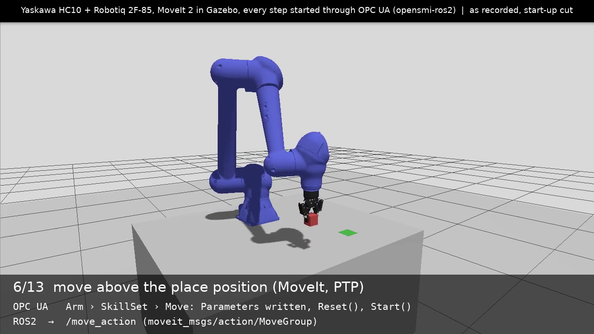

# Example: a Yaskawa HC10 with a Robotiq 2F-85 and MoveIt in Gazebo, operated through OPC UA

A simulated Yaskawa HC10 with a Robotiq 2F-85 gripper stands on a table, planned by MoveIt 2 and
simulated in Gazebo Harmonic. OpenSMI-ROS2 serves it as a Machine with an `Arm` and a `Gripper`
Component, and a small OPC UA client picks a cube up and places it next to where it was, using
nothing but OPC UA.

Everything runs in Docker. One image holds Gazebo, ros2_control, MoveIt, the Machine and the
scenario client, and opensmi-ros2 is installed into it from this repository checkout.

[](media/hc10-pick-and-place.mp4)

[The video](media/hc10-pick-and-place.mp4) shows one run of the scenario from the first motion to
the Halt. A caption names the running step, the OPC UA Skill it starts (or the variables it
reads) and the ROS 2 interface behind it. Nothing is sped up; the simulation runs slower than
real time while it is filmed, because the GUI renders in software. `record.sh` made it (see
[Record a video](#record-a-video)).

## Run it

From this folder, with Docker and Docker Compose v2:

```sh
./run.sh
```

`run.sh` builds the image, starts the simulation and the Machine, runs the scenario and removes
every container and the network again, also when a step fails. The report goes to
`reports/report.md`, the logs of the stack to `reports/stack.log`. The first build downloads about
600 MB of packages and takes a while; later runs reuse the image. Where `archive.ubuntu.com` is
slow, name another Ubuntu mirror: `UBUNTU_MIRROR=http://de.archive.ubuntu.com/ubuntu ./run.sh`.

To keep the cell running and try it yourself:

```sh
docker compose up --build        # Gazebo (headless), MoveIt and the Machine
docker compose run --rm scenario # the pick and place, against the running cell
docker compose down
```

The Machine listens on `opc.tcp://localhost:4855/server` (set `HC10_OPCUA_PORT` for another port).
Connect with any OPC UA client, for example UaExpert. opensmi's default users apply, each with its
name as password: `visitor` may browse and read, `operator` may also take the Lock, start Skills and
write Parameters. This is a simulation setup; [Deployment](../../README.md#deployment) in the
top-level README says what a real one needs.

Gazebo runs headless. To watch, start the GUI as well:

```sh
docker compose --profile gui up --build
```

The GUI joins the headless simulation and draws on the host's X server: on Linux allow it with
`xhost +local:` first, on Windows WSLg provides one, so this works from a WSL shell without more.
It renders in software inside the container, which is slow but enough to watch.

The services talk ROS 2 on domain 72 (Cyclone DDS) over a bridge network of their own, so other ROS 2
systems on the host do not see them.

## Record a video

```sh
./record.sh
```

`record.sh` is `run.sh` with a camera. It also starts the `recorder` service (compose profile
`record`): Gazebo's GUI on a virtual X server (Xvfb) in a container of its own, rendering in
software, with the camera set in [`record/gui.config`](record/gui.config), and ffmpeg capturing that
screen. No desktop is involved. The scenario writes a timeline: when each step started and ended,
which OPC UA nodes it used and what it did there (written Parameters, `Reset()`, `Start()`,
`Halt()`, or reads), named by their browse paths on the server, and the ROS 2 name and type of the
Binding behind each, taken from `machine.toml`. [`record/caption.py`](record/caption.py) cuts the
capture to the steps from the first motion to the end, puts that on a three-line lower third
(step; `OPC UA  Arm › SkillSet › Move: Parameters written, Reset(), Start()`;
`ROS2  →  /move_action (moveit_msgs/action/MoveGroup)`) over the frames the step ran in. A step
shorter than 2.5 s, such as the read of the cube's pose, has its last frame held until its caption
can be read, and the caption says so. Then it exports `media/hc10-pick-and-place.mp4` (H.264, 1280x720, 15 frames per second) and the poster
`media/hc10-pick-and-place.png`, the frame in the middle of the carry. The raw capture and the logs
stay in `reports/recording/`. As with `run.sh`, everything it started is removed at the end. The
video shows the HC10 and 2F-85 models rendered from the descriptions listed under
[Third-party parts](#third-party-parts-and-their-licences).

## What the scenario does

`scenario.py` is an OPC UA client. It never talks to ROS 2, and it reports each step as PASS or FAIL
with what it saw:

1. **Startup.** It takes the Machine's Lock and starts the StartupSkill of the Arm and the Gripper.
   They reach Running only once their required Bindings are on the graph: the joint states,
   MoveIt's `move_action` and the gripper's action. `ListControllers` must show the joint state
   broadcaster, the arm's trajectory controller and the gripper controller active.
2. **Identification and Diagnostics.** It reads the identification of the Machine and both
   Components, and the Diagnostics that the keyed Binding builds from `/diagnostics`, where
   ros2_control's controller manager reports its controllers and hardware.
3. **Monitoring.** It reads the joint states of the arm and the gripper and sees their stamp move
   on with the simulated time.
4. **Pick and place.** Each arm motion is one start of the Arm's `Move` Skill, each gripper motion
   one start of the Gripper's `GripperCommand` Skill: pre-grasp pose above the cube (PTP), open,
   approach (LIN), close on the cube, lift (LIN, and the cube must rise with it), move above the
   place position (PTP), lower (LIN), open, retreat (LIN), and home (PTP to joint positions).
5. **The cube lies at the place position**, within 3 cm, as the Workpiece Component reads it from
   Gazebo.
6. **Halt.** It starts a slow motion, presses Halt while the Skill is Running, and checks that the
   Skill ends Halted and the arm stands still short of its goal. Then the arm goes home.

## How the Machine is declared

[`machine.toml`](machine.toml) is the whole Machine; `opensmi-ros2 serve machine.toml` serves it.

| Component | Binding | ROS 2 interface |
| --- | --- | --- |
| Arm | Monitoring `JointStates` (required) | `/joint_states` |
| Arm | Monitoring `ControllerState` | `/arm_controller/controller_state` |
| Arm | Keyed `Diagnostics` | `/diagnostics` |
| Arm | Method `ListControllers` | `/controller_manager/list_controllers` |
| Arm | Skill `Move` (required) | `/move_action`, `moveit_msgs/action/MoveGroup` |
| Gripper | Monitoring `JointStates` (required) | `/joint_states` |
| Gripper | Skill `GripperCommand` (required) | `/gripper_controller/gripper_cmd`, `control_msgs/action/ParallelGripperCommand` |
| Workpiece | Monitoring `Pose` | `/cube/pose`, the cube's pose from Gazebo |

**Arm motion is MoveIt's own action.** The `Move` Skill is MoveIt's MoveGroup action as it is: its
Parameters are the fields of the MotionPlanRequest, so a client chooses the planning pipeline, the
planner, the speed and the goal. The scenario uses Pilz's industrial motion planner, which plans
deterministically: `PTP` moves in joint space, `LIN` on a straight line. A pose goal is one position
constraint (a small sphere around the target point of the `tcp` link) and one orientation
constraint, written as an array of `moveit_msgs/msg/Constraints` structures; a joint goal is a list
of joint constraints. No scenario node of our own sits between OPC UA and MoveIt. Halt cancels the
action goal, and move_group stops the trajectory.

**The gripper is the same on hardware.** In simulation the 2F-85 is driven by
`parallel_gripper_action_controller/GripperActionController` on gz_ros2_control. On a real gripper
`robotiq_driver` is a ros2_control hardware interface under the same controller, so the
`GripperCommand` Binding stays as it is. On Jazzy that controller serves
`control_msgs/action/ParallelGripperCommand`, not the older `GripperCommand`: its goal is a
`sensor_msgs/JointState` that names the knuckle joint (`robotiq_85_left_knuckle_joint`) and its
target angle in radians, 0 open and 0.8 closed. The force is the controller's `max_effort`. Closing
on the cube stalls the fingers short of 0.8, which the controller reports as a completed goal
(`allow_stalling`), and the scenario takes the stop short of closed as the grasp.

**The finger linkage moves as on the real gripper.** The 2F-85's other five finger joints are mimic
joints of the knuckle. Gazebo's physics engine (DART) cannot enforce mimic constraints itself and
says so in the log, but gz_ros2_control on Jazzy drives the mimic joints that the ros2_control block
lists, so the whole linkage closes and the fingertips grip the cube. No simplified fingers are
needed.

**The Workpiece is a simulation artefact.** A real cell would see the cube with a camera. Gazebo
publishes its pose, the launch file bridges it to `/cube/pose`, and the Workpiece Component makes it
readable, so a client can check where the cube ended.

## What is in this folder

| Path | What it is |
| --- | --- |
| `Dockerfile`, `compose.yaml` | The image and the services: `sim`, `machine`, `scenario`, `gui`, `recorder` |
| `machine.toml`, `server.toml` | The Machine and opensmi's server configuration (endpoint on port 4840 in the container) |
| `scenario.py` | The OPC UA client that runs the pick and place and writes the report |
| `run.sh` | The whole run in one command |
| `record.sh`, `record/` | The same run filmed: the recorder image, its GUI configuration, the capture and the captioning |
| `media/` | The video of a run and its poster, made by `record.sh` |
| `ci.sh` | The same run without Docker, for the CI job |
| `docker/install.sh` | What the image installs, step by step; the CI job runs the same steps |
| `docker/port_hc10.py` | Wraps the fetched ROS1 HC10 description as ROS 2 packages |
| `ros2_ws/src/hc10_robotiq_description` | Our URDF of the cell (table, HC10, 2F-85, `tcp`), the ros2_control setup, the Gazebo world and the simulation launch file |
| `ros2_ws/src/hc10_robotiq_moveit_config` | Our MoveIt 2 configuration (SRDF, kinematics, joint and Cartesian limits, controllers) and the launch file of the whole cell |

## Third-party parts and their licences

Nothing from upstream is copied into this repository. The image installs or fetches each part when
it is built:

| Part | Where it comes from | Licence |
| --- | --- | --- |
| HC10 description (URDF and meshes) | `ros-industrial/motoman`, branch `kinetic-devel`, package `motoman_hc10_support` (and `motoman_resources` for its colours), fetched at commit `f951b28` | BSD (`package.xml`); the repository's source headers carry the three-clause text |
| Robotiq 2F-85 description | `robotiq_description` (0.0.1) from PickNikRobotics/ros2_robotiq_gripper, apt `ros-jazzy-robotiq-description` | BSD-3-Clause |
| MoveIt 2: move_group, Pilz industrial motion planner, OMPL, KDL | apt `ros-jazzy-moveit-ros-move-group` and the planner, kinematics and controller-manager packages | BSD-3-Clause |
| Gazebo Harmonic, ros_gz | apt `ros-jazzy-ros-gz-sim`, `ros-jazzy-ros-gz-bridge` | Apache-2.0 |
| ros2_control, gz_ros2_control, ros2_controllers | apt | Apache-2.0 |
| ROS 2 Jazzy | Docker Hub `ros:jazzy-ros-base` (pinned by digest), apt | Apache-2.0 (most packages), BSD-3-Clause (some) |
| Cyclone DDS | apt `ros-jazzy-rmw-cyclonedds-cpp` | EPL-2.0 or BSD-3-Clause (EDL-1.0) |
| opensmi-server, opensmi-core | PyPI and GitHub, pinned in `constraints.txt` | MIT |
| asyncua, a dependency of opensmi-ros2 itself | PyPI | LGPL-3.0 |

The ROS1 HC10 description has no inertial values. `docker/port_hc10.py` adds rough ones (the
masses add up to the HC10's 47 kg) so Gazebo can simulate the arm; they are estimates, not
Yaskawa's data. Only the HC10 itself, the base variant, is used.

## Simplifications

- The table is part of the robot's URDF, so MoveIt knows it and plans around it. The cube is not in
  MoveIt's planning scene.
- The arm is position-controlled in Gazebo (gz_ros2_control turns position commands into joint
  velocities), so the inertias above only need to be plausible.
- The grasp is a friction grasp: the fingers close on the cube with the gripper controller's
  effort, and friction holds it (the finger pads and the cube have a friction coefficient of 2).
  The fingers close along y, the direction the cube is carried in, so the pads push it along
  rather than holding it by friction alone, and the carry runs at 20 % speed.
- The real driver of an HC10 is MotoROS2, which offers the same FollowJointTrajectory interface
  MoveIt executes on here.

## In CI

The `scenario` job of `.github/workflows/examples.yml` runs `ci.sh` on manual start. It runs without
Docker, in a plain ROS 2 Jazzy job container: `ci.sh` installs what the image would hold with the same `docker/install.sh`, starts the
simulation and the Machine as processes, runs the scenario and keeps `reports/` as an artifact.
