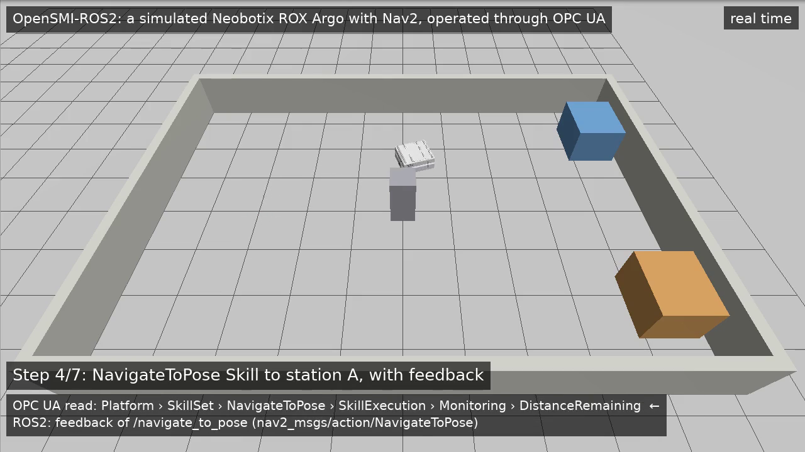

# Neobotix ROX Argo with Nav2 in Gazebo, operated through OPC UA

This example serves a simulated [Neobotix ROX](https://github.com/neobotix/rox) with the omnidirectional
Argo drive as an OPC UA Machine, and operates it through OPC UA alone. Gazebo Harmonic simulates the
robot in a small room of our own, Neobotix's Nav2 configuration drives it, and `opensmi-ros2 serve`
serves the Machine declared in [`machine.toml`](machine.toml). A scripted OPC UA client walks through
a scenario and writes a report with PASS or FAIL per step.

Everything runs in Docker. You need Docker with the compose plugin, about 8 GB of disk for the
image, and no ROS 2 on the host.

[](media/rox-argo.mp4)

[The video](media/rox-argo.mp4) shows one whole run. The caption names the step in progress and its
result, and below it which OPC UA node the client calls or reads and which ROS 2 interface that
reaches. It runs in real time, except for the short steps, which are slowed down so their captions
can be read; the corner says which. [`record.sh`](record.sh) made it (see
[Record a video](#record-a-video)).

## Run the scenario

From the repository root:

```sh
examples/nav2-rox-argo/run.sh
```

The first run builds the image, which takes a while (Gazebo, Nav2 and the Neobotix packages from
source). If the Ubuntu archive is slow from where you are, name a closer mirror for the build, for
example `UBUNTU_MIRROR=http://ftp.fau.de/ubuntu examples/nav2-rox-argo/run.sh`. The script then
starts the simulation and the Machine, waits until Nav2 reports itself active, runs the scenario and
copies the report to `examples/nav2-rox-argo/reports/`. Afterwards it removes every container and
the network it started, also when a step fails or you press Ctrl+C. The exit status is 0 only if
every step passed. The scenario itself takes about a minute.

The scenario logs in as `operator`, takes the Machine's Lock and runs these steps:

| Step | What it does through OPC UA | What it checks |
| --- | --- | --- |
| Startup | Starts the Platform's StartupSkill | It reaches Running once odometry and scans arrive and both Nav2 lifecycle managers report their nodes active |
| Identification and Diagnostics | Reads the Machine's and the Platform's Identification and the Diagnostics group | The values are there, with one member per diagnostic entry |
| Monitoring while moving | Sends the robot towards station A with the NavigateToPose Skill | Odometry, the laser scan's stamp and the drive's diagnostic message change while it drives |
| NavigateToPose to station A, then B | Follows the Skill to its end, then starts it again for station B | The Skill completes, the robot is within 0.35 m of the station, and the feedback (DistanceRemaining) counts down in the Skill's Monitoring |
| Halt | Starts a drive home and presses Halt once the robot moves | The Skill is Halted, and the robot stands still well short of home |
| Return home | Starts the drive home again | The Skill completes at home |

## Use your own OPC UA client

```sh
cd examples/nav2-rox-argo
docker compose up --build
```

This starts the simulation and the Machine and leaves them running. The Machine is at
`opc.tcp://localhost:4840/server` (if another OPC UA server already has port 4840, set `OPCUA_PORT`
to publish it on another one), with opensmi's
default users: `visitor`, `orchestrator` and `operator`, each with its name as password. Under
Objects, Machines, RoxArgo, Components, Platform you find the Monitoring, the NavigateToPose Skill,
the StartupSkill and the Methods. To run the scenario against the running stack:
`docker compose run --rm scenario`. Stop everything with `docker compose down`.

To watch the robot, add the Gazebo window:

```sh
docker compose --profile gui up --build
```

The simulation always runs headless; the `gui` service is a Gazebo client in a container of its own
that joins it. Under WSL it uses WSLg's display, on a Linux desktop the X server (allow local
connections with `xhost +local:` first). It renders in software, so expect a modest frame rate.

## Record a video

```sh
examples/nav2-rox-argo/record.sh
```

does what `run.sh` does and films it. It adds the `recorder` service (profile `record`), which shows
the Gazebo window on a virtual display inside its own container and films it with ffmpeg, so no
display on the host is needed. The window's camera is set in
[`recording/gui.config`](recording/gui.config). The scenario writes when each step started and ended
and what it did when (`scenario.py --timeline`): the browse path of the Skill or variable it used,
read from the server, and the ROS 2 name and type behind it, read from the Binding in `machine.toml`,
so a renamed Binding cannot leave a stale caption. [`recording/make_video.py`](recording/make_video.py)
cuts the film to the scenario, captions it from the timeline, and slows down any stretch whose
caption would be on screen for less than 3.5 seconds. The result replaces
`media/rox-argo.mp4` (H.264, 1280 by 720, no sound) and the poster `media/rox-argo-poster.png`. The
recorder's software rendering is limited to a few cores, so it does not slow the simulation and Nav2
down. If a step fails anyway, the caption shows FAIL and the exit status is not 0; record again
rather than keep that video.

## What is in this folder

| File | Purpose |
| --- | --- |
| `Dockerfile` | One image for every service (stage `example`), filled by `install.sh`; the stage `recorder` adds ffmpeg |
| `install.sh` | What the image holds, in steps: ROS 2 Jazzy packages, Gazebo Harmonic and Nav2, the Neobotix packages built from source at pinned commits, opensmi-ros2 from this checkout with `constraints.txt`, the map and the Nav2 parameters. The Dockerfile and `ci.sh` both run it |
| `compose.yaml` | The services `sim`, `machine`, `scenario` (profile `scenario`), `gui` (profile `gui`) and `recorder` (profile `record`), on their own bridge network and ROS 2 domain 71 |
| `machine.toml`, `server.toml` | The Machine and its opensmi server configuration, served with `opensmi-ros2 serve machine.toml` |
| `world.sdf` | The room: 10 m by 7 m, a pillar, station A and station B. The robot spawns at the origin, which is home |
| `make_map.py` | Draws the map Nav2 localizes against from the boxes in `world.sdf`, when `install.sh` runs |
| `simulation_launch.py` | Starts Neobotix's simulation and navigation launch files with this world and map, and the diagnostics node |
| `sim_diagnostics.py` | Publishes `/diagnostics` for the drive and the two laser scanners, standing in for the relayboard the simulation lacks |
| `scenario.py` | The OPC UA client that runs the scenario and writes the report |
| `run.sh` | Build, run the scenario, collect the report, clean up |
| `ci.sh` | The same without Docker, for the CI job: install, run the stack as processes, run the scenario |
| `record.sh`, `recording/` | The same, filmed: the recorder's start script, its Gazebo window layout and the cut with captions |
| `media/` | The video of one run and its poster frame |

## How the Machine is declared

The Machine has one Component, `Platform`, with Bindings to what the simulation and Nav2 offer:

- `Odom` (`/odom`) and `Scan` (`/scan`, both scanners relayed onto one topic by rox_bringup, read at
  most twice a second). Both are required, so the StartupSkill waits for them.
- `Diagnostics` (`/diagnostics`), a keyed Binding with one member per entry and a `WorstLevel`.
  Besides the two entries of `sim_diagnostics.py`, both Nav2 lifecycle managers publish their health
  there.
- `NavigateToPose`, an action Skill. The goal pose is its Parameters, Nav2's feedback its Monitoring,
  and Halt cancels the goal.
- `NavigationIsActive` and `ClearGlobalCostmap`, two Methods.
- `Localization` and `Navigation`, the two lifecycle managers of neo_nav2_bringup, which make up the
  StartupSkill. Nav2 starts its nodes itself, so the StartupSkill finds them active and from then on
  follows them.

The simulation has no relayboard, so there is no battery state to bind. On the real robot the
relayboard's topics would be the next Bindings to add.

## Neobotix launch arguments and the map

`simulation_launch.py` includes `rox_bringup/launch/bringup_sim_launch.py` with `rox_type:=argo`,
`world:=<this folder>/world.sdf` (the launch file takes an absolute SDF path) and
`headless_simulation:=True`, and `rox_navigation/launch/navigation.launch.py` with `rox_type:=argo`,
`use_sim_time:=True`, `use_rviz:=False`, `map:=<the drawn map>` and
`nav2_params_file:=<navigation.yaml>`. Navigation starts ten seconds after the simulation.

`navigation.yaml` is Neobotix's `navigation_omni.yaml` with one value changed by `install.sh`: the behavior tree waits 200 ms instead of 20 ms for a Nav2 server to accept a goal. On a busy
host, with other simulations running or the recorder filming, 20 ms ran out and Nav2 aborted the
drive.

`rox_navigation` needs a map of the world it localizes in (neo_localization2 matches the laser scans
against it), so the example cannot use one of the shipped Neobotix maps. `make_map.py` draws it from
`world.sdf` when `install.sh` runs, and the map's origin is the world's origin, where the robot
spawns.

The scanners are `gpu_lidar` sensors, which need a renderer even when Gazebo has no window. The
simulation therefore runs under Xvfb with software rendering.

## Upstream parts and their licences

The image clones and builds these repositories at the commits pinned in `install.sh`. Nothing of
them is copied into this repository.

| Repository | Used for | Licence |
| --- | --- | --- |
| [neobotix/rox](https://github.com/neobotix/rox) (branch `jazzy`) | `rox_description`, `rox_bringup`, `rox_navigation` | BSD (as declared in its `package.xml` files) |
| [neobotix/neo_nav2_bringup](https://github.com/neobotix/neo_nav2_bringup) (branch `jazzy`) | The Nav2 and localization launch files `rox_navigation` includes | Apache-2.0 |
| [neobotix/neo_localization2](https://github.com/neobotix/neo_localization2) (branch `jazzy`) | Localization against the map | MIT |
| [neobotix/neo_local_planner2](https://github.com/neobotix/neo_local_planner2) (branch `jazzy`) | Nav2's local planner in the ROX configuration | BSD (as declared in its `package.xml`) |
| [neobotix/neo_gz_worlds](https://github.com/neobotix/neo_gz_worlds) (branch `main`) | Gazebo models `bringup_sim_launch.py` puts on the resource path; the example uses its own world | Apache-2.0 |

ROS 2 Jazzy, Gazebo Harmonic, Nav2, ros_gz, Cyclone DDS and the other binary packages come from
packages.ros.org and Ubuntu under their own licences. The base image is `ros:jazzy-ros-base` at the
digest the repository's CI pins; packages.ros.org keeps only the latest version of each package, so a
rebuild later picks up newer ROS 2 packages.

## In CI

The manual `scenario` job of `.github/workflows/examples.yml` runs [`ci.sh`](ci.sh) and keeps the
report and the logs as an artifact. `ci.sh` builds no image: it runs `install.sh all` in the job
container, starts Xvfb, the simulation and,
once Nav2 is active, the Machine as processes, runs the scenario and stops them again. The `images` job builds the
image on every change and pushes it to the GitHub container registry from `main`. `UBUNTU_MIRROR`
reaches `install.sh` like the environment variable does locally.
